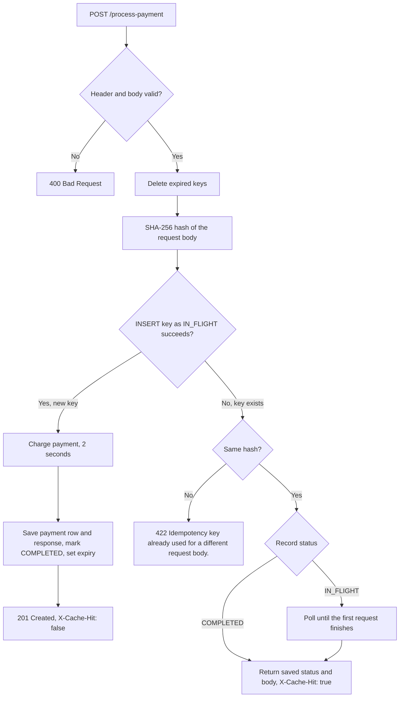
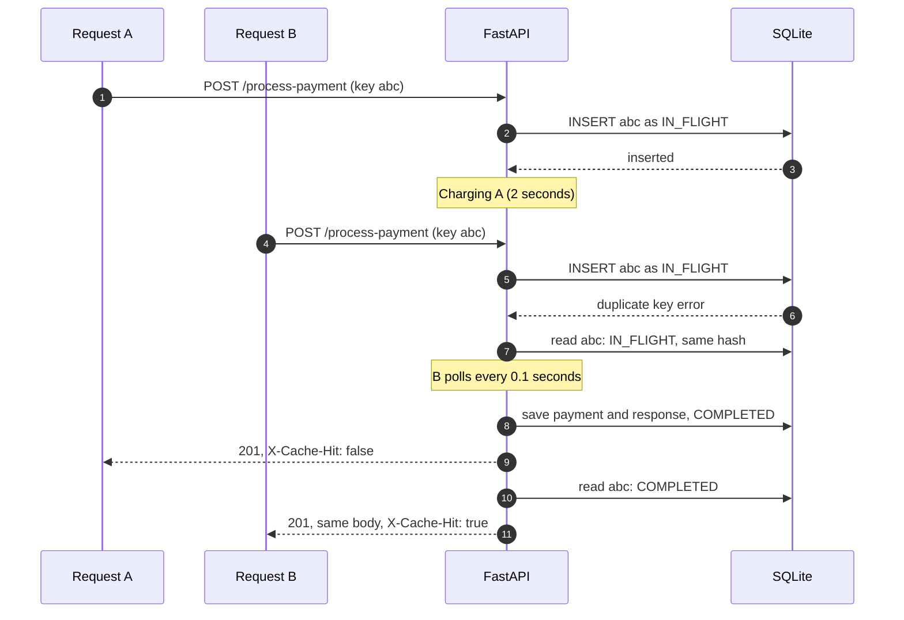

# Idempotency Gateway: the "Pay-Once" Protocol

A payment API for **FinSafe Transactions Ltd.** that guarantees a payment is charged **exactly once**, however many times a client retries the same request.

**Stack:** Python 3.10+, FastAPI, SQLAlchemy 2.0, SQLite, Pytest.

---

## What is done

| Requirement | Status | Where |
| --- | --- | --- |
| `POST /process-payment` with `Idempotency-Key` header | Done | `routers/payment_router.py` |
| First request: 2-second processing, `201`, `"Charged 100 GHS"` | Done | `services/payment_service.py` |
| Duplicate request: same body and status, no new charge, `X-Cache-Hit: true` | Done | `services/idempotency_service.py` |
| Same key with different body: `422` with the required message | Done | `services/idempotency_service.py` |
| Bonus: a request that arrives during processing waits and gets the same result | Done | `services/idempotency_service.py` |
| Developer's Choice: idempotency keys expire after 24 hours | Done | `services/idempotency_service.py`, `repositories/idempotency_repository.py` |
| Tests | 7 tests | `tests/test_process_payment.py` |

---

## 1. Architecture Diagram

### Request flow



### Two identical requests at the same time



---

## 2. Setup Instructions

```bash
git clone https://github.com/<your-username>/Idempotency-gateway.git
cd Idempotency-gateway
python -m venv .venv
source .venv/bin/activate          # Windows: .venv\Scripts\activate
pip install -r requirements.txt
uvicorn main:app --reload
```

The API runs on **http://localhost:8000**. Interactive docs: **http://localhost:8000/docs**.

The SQLite database file `idempotency_gateway.db` is created automatically on first start.

### Run the tests

```bash
pytest -v
```

### Postman collection

`idempotency-gateway.postman_collection.json` holds every request with automatic checks.

1. Start the server: `uvicorn main:app --reload`
2. In Postman: **Import** → choose the file.
3. Open the collection → **Run** → **Run Idempotency Gateway**. The requests run in order and every check should pass.

| # | Request | Expected |
| --- | --- | --- |
| 1 | First payment (a new key is generated) | `201`, `"Charged 100 GHS"`, `X-Cache-Hit: false` |
| 2 | Retry with the same key and body | `201`, same `transaction_id`, `X-Cache-Hit: true`, under 1 second |
| 3 | Same key, amount 500 | `422` with the required message |
| 4 | No `Idempotency-Key` header | `400` |
| 5 | Amount -5 | `400` |

The `baseUrl` collection variable is `http://localhost:8000`; change it if you use another port. The two-requests-at-once case is covered by the automated test and the `curl` example below, because Postman sends requests one at a time.

### Environment variables (optional)

| Variable | Default | Meaning |
| --- | --- | --- |
| `DATABASE_URL` | `sqlite:///./idempotency_gateway.db` | Database connection |
| `PROCESSING_DELAY_SECONDS` | `2` | Simulated payment time |
| `KEY_TTL_SECONDS` | `86400` (24 hours) | How long a completed key is remembered |
| `IN_FLIGHT_WAIT_SECONDS` | `30` | Longest a duplicate waits for the first request |
| `PORT` | `8000` | Port when started with `python main.py` |

---

## 3. API Documentation

### `POST /process-payment`

**Headers**

| Header | Required | Rule |
| --- | --- | --- |
| `Content-Type` | Yes | `application/json` |
| `Idempotency-Key` | Yes | 1 to 255 characters, not only spaces |

**Body**

| Field | Type | Rule |
| --- | --- | --- |
| `amount` | number | Greater than 0 |
| `currency` | string | 3 letters, for example `GHS`. Saved in upper case |

No other fields are allowed.

#### Example 1: first request

```bash
curl -i -X POST http://localhost:8000/process-payment \
  -H "Content-Type: application/json" \
  -H "Idempotency-Key: order-1001" \
  -d '{"amount": 100, "currency": "GHS"}'
```

Response after about 2 seconds:

```http
HTTP/1.1 201 Created
X-Cache-Hit: false

{
  "status": "success",
  "message": "Charged 100 GHS",
  "transaction_id": "txn_5f1c2a...",
  "amount": 100,
  "currency": "GHS",
  "processed_at": "2026-11-19T18:30:00.123456Z"
}
```

#### Example 2: retry with the same key and body

Send the same command again. The response comes back instantly with the same body (same `transaction_id`) and `X-Cache-Hit: true`. The customer is not charged again.

#### Example 3: same key, different amount

```bash
curl -i -X POST http://localhost:8000/process-payment \
  -H "Content-Type: application/json" \
  -H "Idempotency-Key: order-1001" \
  -d '{"amount": 500, "currency": "GHS"}'
```

```http
HTTP/1.1 422 Unprocessable Entity

{"detail": "Idempotency key already used for a different request body."}
```

#### Example 4: two requests at the same time

```bash
for i in 1 2; do
  curl -s -i -X POST http://localhost:8000/process-payment \
    -H "Content-Type: application/json" \
    -H "Idempotency-Key: order-2002" \
    -d '{"amount": 50, "currency": "USD"}' &
done; wait
```

Both finish after about 2 seconds with the same `transaction_id`. One response has `X-Cache-Hit: false`, the other `X-Cache-Hit: true`.

#### Responses

| Status | When |
| --- | --- |
| `201` | Payment processed, or a replay of a processed payment |
| `400` | Missing `Idempotency-Key`, invalid JSON, or invalid `amount` / `currency` |
| `409` | A duplicate waited 30 seconds and the first request had still not finished |
| `422` | Key already used with a different body |

### `GET /health`

Returns `{"status": "ok"}`.

---

## 4. Project Structure

```
idempotency-gateway/
├── main.py                              # Creates the app, tables, validation handler, routers
├── models/
│   ├── base.py                          # SQLAlchemy Base and utc_now()
│   ├── idempotency_record.py            # Table: idempotency_records
│   └── payment.py                       # Table: payments
├── schemas/
│   └── payment.py                       # Request body and Idempotency-Key header validation
├── repositories/
│   ├── database.py                      # Engine, session, get_db() with yield
│   ├── idempotency_repository.py        # All commits for idempotency_records
│   └── payment_repository.py            # All commits for payments
├── services/
│   ├── exceptions.py                    # Business errors
│   ├── payment_service.py               # Simulated charge (2-second delay)
│   └── idempotency_service.py           # Pay-once logic
├── routers/
│   ├── health_router.py                 # GET /health
│   └── payment_router.py                # POST /process-payment
├── tests/
│   ├── conftest.py                      # Test database and client
│   └── test_process_payment.py          # Endpoint tests
├── idempotency-gateway.postman_collection.json
├── requirements.txt
└── pytest.ini
```

| Folder | Responsibility |
| --- | --- |
| `models` | SQLAlchemy tables |
| `schemas` | Input types and validation (Pydantic) |
| `repositories` | Database access: the session, `yield`, every `commit` and `rollback` |
| `services` | Business logic; no SQL and no HTTP |
| `routers` | Endpoints only: receive the request, call a service, return the response |

### Database tables

**idempotency_records**

| Column | Type | Meaning |
| --- | --- | --- |
| `key` | string, primary key | The `Idempotency-Key` header |
| `request_hash` | string | SHA-256 of the request body |
| `status` | string | `IN_FLIGHT` or `COMPLETED` |
| `response_status_code` | integer | Saved status code |
| `response_body` | JSON | Saved response body |
| `created_at` | datetime | When the key was first seen |
| `expires_at` | datetime | When the key is forgotten (empty while in flight) |

**payments**

| Column | Type | Meaning |
| --- | --- | --- |
| `id` | integer, primary key | Row id |
| `transaction_id` | string, unique | Returned to the client |
| `idempotency_key` | string | Key that created this payment |
| `amount` | float | Amount charged |
| `currency` | string | Currency code |
| `created_at` | datetime | When it was charged |

---

## 5. Design Decisions

1. **The database decides who processes a payment.** The key is the primary key of `idempotency_records`. The first request INSERTs it as `IN_FLIGHT` before charging. A second request with the same key gets a duplicate-key error from the database, so it can never charge. This works across threads and server processes, not just inside one process.
2. **The request body is hashed.** The body is validated, turned into JSON with sorted keys, then hashed with SHA-256. `{"amount":100,"currency":"GHS"}` and `{"currency":"ghs","amount":100}` give the same hash, because they are the same payment.
3. **The exact response is saved.** Status code and body are stored. A replay returns them unchanged; only `X-Cache-Hit` differs.
4. **Duplicates wait instead of failing (bonus).** A duplicate that finds `IN_FLIGHT` checks the database every 0.1 seconds until the record becomes `COMPLETED`, then returns the saved result. It does not get `409` and does not charge again. After 30 seconds it gives up with `409` so a request never hangs forever.
5. **Failures do not lock the key.** Validation errors are rejected before the key is saved. If charging raises an error, the key is deleted so the client can retry.
6. **`400` for bad input, `422` only for key reuse.** FastAPI normally returns `422` for validation errors. A custom handler in `main.py` turns them into `400`, so `422` always means "this key was used for a different payment".
7. **`payments` table.** Every real charge is a row. This is how the tests prove that a payment was charged once.

---

## 6. The Developer's Choice: Key Expiry (24-hour TTL)

**What it does.** When a payment completes, its key gets `expires_at = now + 24 hours`. At the start of each request, expired keys are deleted. A key used again after it expires is treated as a new payment. Keys that are still `IN_FLIGHT` never expire.

**Why I added it.**

1. **The table would grow forever.** A payment processor handles millions of payments. Without expiry every key is kept forever, so storage grows and lookups slow down.
2. **Retries happen within minutes, not months.** Clients retry after network timeouts. A 24-hour window covers every realistic retry. Stripe keeps its idempotency keys for 24 hours too.
3. **It is configurable.** `KEY_TTL_SECONDS` changes the window without a code change.

---

## 7. Tests

`pytest -v` runs 7 tests against a temporary SQLite database, with the delay shortened to 0.5 seconds.

| Test | What it proves |
| --- | --- |
| `test_first_request_processes_the_payment` | `201`, `"Charged 100 GHS"`, `X-Cache-Hit: false`, processing delay, one charge |
| `test_duplicate_request_replays_saved_response_without_charging_again` | Same body and status, `X-Cache-Hit: true`, instant, still one charge |
| `test_same_key_with_different_body_is_rejected` | `422` with the exact message |
| `test_missing_idempotency_key_returns_400` | Header is required |
| `test_invalid_body_returns_400` | Negative amount is rejected |
| `test_concurrent_duplicates_wait_and_charge_once` | Bonus: second request waits, same result, one charge |
| `test_expired_key_is_processed_as_a_new_payment` | Developer's Choice: an expired key charges again |
